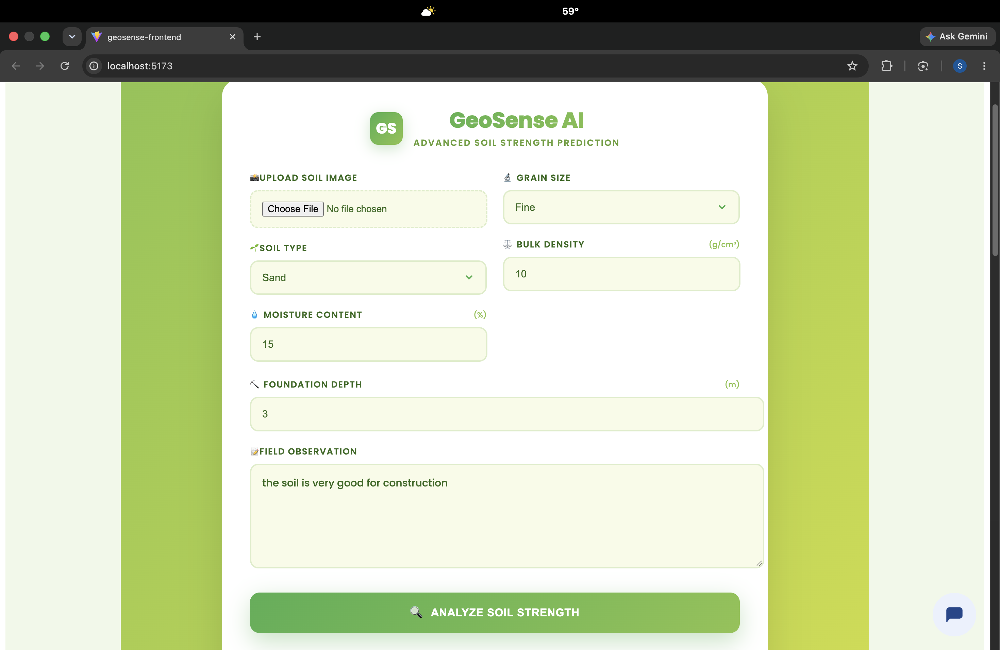
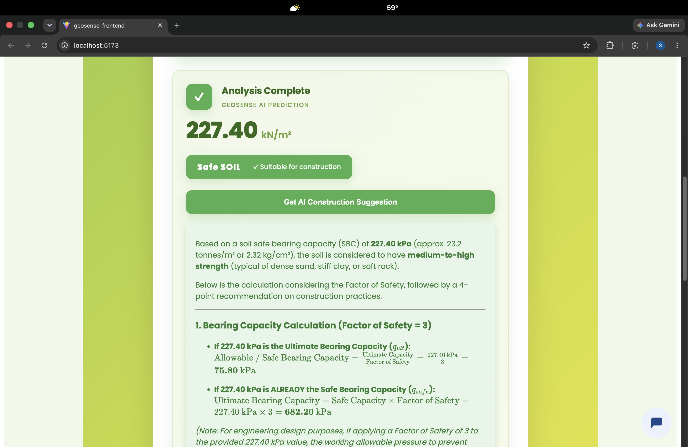
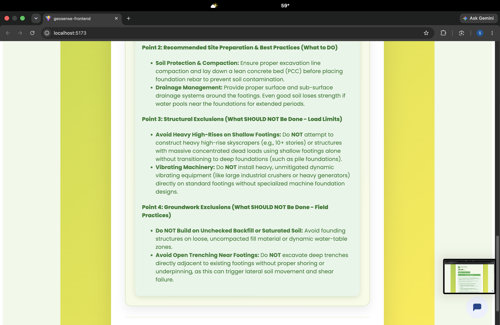
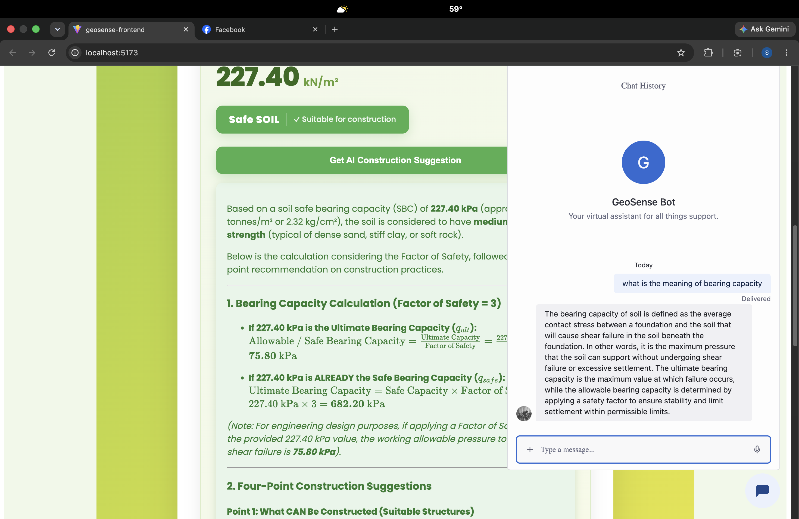

<div align="center">

# 🌱 GeoSense AI

### **CESS HACKATHON 2025 WINNING PROJECT**

<p><em>Smart soil intelligence for safer, stronger, and more sustainable construction.</em></p>

<p>
  
  
  
</p>



</div>

GeoSense is a geotechnical analysis platform for soil classification, field-observation analysis, and soil bearing-capacity prediction. It combines a FastAPI machine-learning backend with a React web application and an Expo/React Native mobile application.

> **Important:** GeoSense provides engineering estimates for experimentation and educational use. Always consult a qualified geotechnical or structural engineer before making construction decisions.

## ✨ Why GeoSense

GeoSense turns complex soil information into practical, understandable insight. Upload a soil image, enter field observations, inspect geographic data, and receive a bearing-capacity estimate with AI-assisted construction guidance — all from one connected platform.

## 🖥️ Product preview

<div align="center">
  <table>
    <tr>
      <td></td>
      <td></td>
    </tr>
    <tr>
      <td align="center"><strong>AI bearing-capacity prediction</strong></td>
      <td align="center"><strong>Construction recommendations</strong></td>
    </tr>
  </table>
  <br>
  
  <br>
  <em>GeoSense Bot provides an interactive geotechnical assistant experience.</em>
</div>

## Features

- Image-based classification of clay, sand, gravel, and silt
- Soil bearing-capacity prediction from geotechnical parameters
- Natural-language processing of field observations
- AI-generated construction suggestions based on predicted bearing capacity
- Geographic soil-data lookup by latitude and longitude
- React web interface
- Expo/React Native mobile interface
- Jupyter notebooks for data exploration and model training

## Repository structure

```text
GeoSense/
├── backend.py                         # FastAPI backend
├── soil_engine_core.py                # Image classification and feature extraction
├── app.py                             # Streamlit client using the backend API
├── app1.py                            # Standalone Streamlit predictor
├── model1.pkl                         # Bearing-capacity model
├── nlp_model.pkl                      # Field-observation NLP model
├── dataset/                           # Soil image dataset
├── *.csv                              # Training and geographic data
├── *.ipynb                            # Analysis and training notebooks
├── requirements.txt                   # Python dependencies
├── geosense-frontend/                 # Vite/React web application
└── geosense-mobile/                   # Expo/React Native mobile application
```

## Requirements

- Python 3.10 or newer
- Node.js 18 or newer
- npm
- Homebrew `libomp` on macOS, required by LightGBM:

  ```bash
  brew install libomp
  ```

## Local backend setup

From the repository root:

```bash
python3 -m venv .venv
source .venv/bin/activate
python -m pip install -r requirements.txt
```

Create a `.env` file in the repository root:

```env
GEMINI_API_KEY=your_gemini_api_key
```

Start the API:

```bash
python -m uvicorn backend:app --reload
```

The backend runs at `http://127.0.0.1:8000`.

- Interactive API documentation: `http://127.0.0.1:8000/docs`
- OpenAPI schema: `http://127.0.0.1:8000/openapi.json`

Do not commit `.env` or expose API keys in source control.

## Local web application setup

In a second terminal:

```bash
cd geosense-frontend
npm install
npm run dev
```

The Vite development server will print the local frontend URL. During local development, the web application expects the backend at `http://localhost:8000`.

To use a deployed backend, replace the hard-coded backend URL in the frontend with a Vite environment variable:

```env
VITE_API_URL=https://your-backend.example.com
```

Then use:

```js
const API_URL = import.meta.env.VITE_API_URL;
```

## Mobile application setup

```bash
cd geosense-mobile
npm install
npm start
```

The mobile application must use a publicly reachable backend URL. A mobile device cannot access the computer's `localhost`. For local device testing, use a tunnel such as ngrok:

```bash
ngrok http 8000
```

Update the mobile API base URL with the tunnel URL. For production, use the deployed backend URL instead.

## API routes

| Method | Route | Description |
|---|---|---|
| `POST` | `/predict` | Predict bearing capacity and return a safety classification |
| `POST` | `/image` | Classify a soil image |
| `POST` | `/aisuggest` | Generate construction suggestions with Gemini |
| `POST` | `/get_geo_data` | Find the nearest soil record for coordinates |

## Deployment with Render

Render should host the backend and frontend as separate services.

### Backend Web Service

Create a **Web Service** connected to this repository:

```text
Root Directory: .
Build Command: pip install -r requirements.txt
Start Command: uvicorn backend:app --host 0.0.0.0 --port $PORT
```

Add this environment variable in Render:

```text
GEMINI_API_KEY=your_gemini_api_key
```

Confirm the deployment at:

```text
https://your-backend.onrender.com/docs
```

### Frontend Static Site

Create a **Static Site** connected to the same repository:

```text
Root Directory: geosense-frontend
Build Command: npm install && npm run build
Publish Directory: dist
```

Set the frontend environment variable:

```text
VITE_API_URL=https://your-backend.onrender.com
```

Update FastAPI CORS in `backend.py` to allow the deployed frontend domain:

```python
origins = [
    "https://your-frontend.onrender.com",
]
```

After changing CORS or backend code, redeploy the backend service.

## Development and validation

Build and lint the web application:

```bash
cd geosense-frontend
npm run lint
npm run build
```

Run the Streamlit application:

```bash
streamlit run app.py
```

## Data and models

The repository includes trained model files and datasets used by the applications:

- `model1.pkl` — bearing-capacity prediction pipeline
- `nlp_model.pkl` — field-observation text model
- `soil_geo_data.csv` — geographic soil records
- `synthetic_soil_bearing_capacity.csv` — bearing-capacity training data
- `nlp_field_observation.csv` — field-observation data
- `nlp_field_observation_augmented.csv` — augmented field-observation data
- `dataset/` — labeled soil images

The model files are loaded when the backend starts, so they must be present in the backend deployment.

## Collaborators

- [Shreyam Regmi](https://github.com/Nortcele7)
- [Shubham Pathak](https://github.com/ShubhamPathak1)
- [Prince Parajuli](https://github.com/princeparajuli)

## License

This project is licensed under the MIT License. See [LICENSE](LICENSE) for details.
